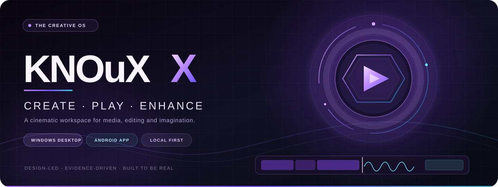
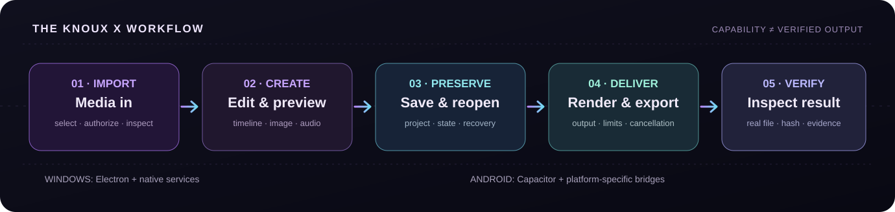
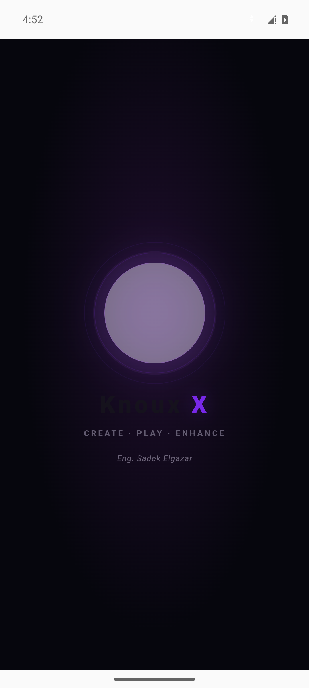
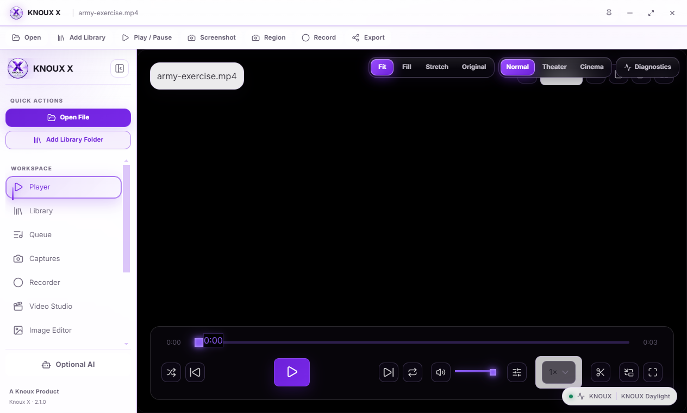
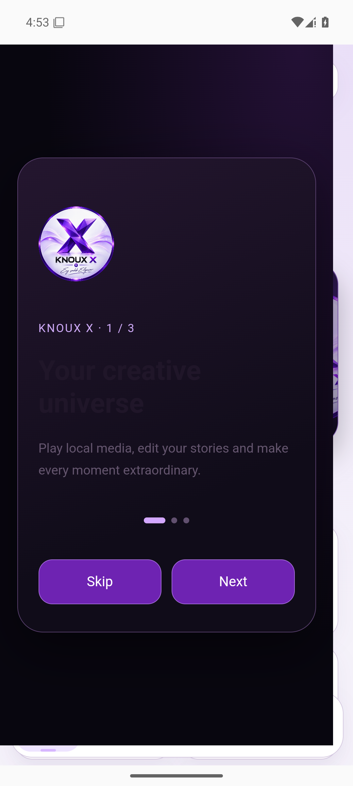
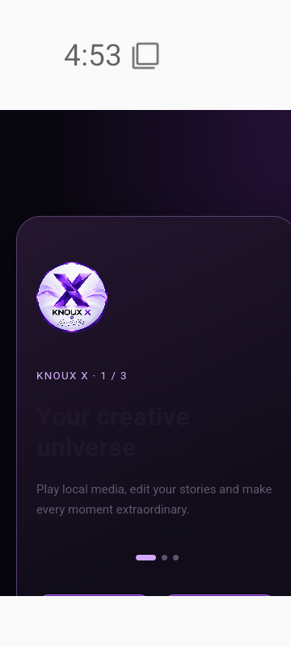

  

### Your media. Your ideas. One creative universe.

**A design-led, local-first media player and creative suite for Windows — with an Android companion built on Capacitor.**

[**Explore the experience**](#-the-experience) · [**Get started**](#-get-started) · [**Windows**](#-windows-desktop) · [**Android**](#-android-companion) · [**Architecture**](#-architecture) · [**العربية**](#-بالعربية--knoux-x)

CI badges show the **current** workflow state on `main`; a successful build does not certify every device, codec, provider or platform path.

---

> [!IMPORTANT]
> **An ambitious product, described with engineering honesty.** KNOUX X contains working desktop/media paths and Android platform adapters, but functionality is **not identical** across platforms. AI generation requires a genuinely configured and available provider. An APK produced with a CI acceptance certificate is **not** a production-signed Play Store release. See [Capability & verification](#-capability--verification), [Known limitations](#-known-limitations--engineering-roadmap), and the [evidence](#-tests-ci--evidence) before treating a specific capability as release-ready.

## ✦ At a glance

<table>
<tr>
<td width="50%" valign="top">

**🎬 PLAY**

Open media, navigate your library and sessions, preview video and audio, and work with player controls backed by the platform's real media capabilities.

**✂️ EDIT**

Compose timeline-based projects, trim and split media, work with image tools and retouch, then preserve projects for later sessions.

</td>
<td width="50%" valign="top">

**🎨 CREATE**

Move between Video Studio, Image Studio, Audio Lab, slideshow, recording and export workflows without losing the KNOUX visual identity.

**🧭 VERIFY**

Prefer real files, explicit status, visible limitations, reproducible tests and evidence over simulated success or decorative “AI complete” messages.

</td>
</tr>
</table>

<table>
<tr>
<th>Product identity</th><th>How it is implemented</th>
</tr>
<tr><td><strong>Windows desktop</strong></td><td>Electron native shell + React/TypeScript UI + local service/IPC integrations; not a hosted website pretending to be a desktop app.</td></tr>
<tr><td><strong>Android companion</strong></td><td>Installable APK using Capacitor and an embedded Android WebView, with native/mobile bridges where implemented. Not a full Jetpack Compose rewrite.</td></tr>
<tr><td><strong>Design language</strong></td><td>Midnight violet, layered glass, subtle motion, adaptive mobile navigation, bilingual interface work and official KNOUX brand assets.</td></tr>
<tr><td><strong>Version source</strong></td><td>`package.json` is the release-version authority; the package currently declares `2.1.0`.</td></tr>
<tr><td><strong>Project approach</strong></td><td>Local-first media workflows, explicit external-provider configuration, scoped permissions and testable output contracts.</td></tr>
</table>

## 🗺️ Navigate this README

<strong>Product, platform, engineering and community guide</strong>

- [✦ At a glance](#-at-a-glance) — product identity and positioning
- [🎭 The experience](#-the-experience) — player, studios and the interface
- [📷 Real interface evidence](#-real-interface-evidence) — repository-hosted QA captures
- [🧩 Feature map](#-feature-map) — code-backed areas and limitations
- [🪟 Windows desktop](#-windows-desktop) — the native shell and Windows packaging
- [📱 Android companion](#-android-companion) — APK, Capacitor and mobile boundaries
- [🚀 Get started](#-get-started) — prerequisites, development and scripts
- [🏗️ Architecture](#-architecture) — source layout and service boundaries
- [🔌 AI & external providers](#-ai--external-providers) — real routing versus mock data
- [🔐 Security, privacy & data](#-security-privacy--data) — permissions and safe practices
- [🧪 Tests, CI & evidence](#-tests-ci--evidence) — actual verification sources
- [🧰 Troubleshooting](#-troubleshooting) — common failure modes
- [🛣️ Known limitations & roadmap](#-known-limitations--engineering-roadmap) — what's still unfinished
- [🤝 Contributing](#-contributing) — engineering and PR expectations
- [📜 License & acknowledgments](#-license--acknowledgments)
- [🇦🇪 بالعربية — KNOUX X](#-بالعربية--knoux-x) — ملخص وتثبيت وحدود واقعية

---

## 🎭 The experience

### 01 / A player that belongs inside a creative workspace

The playback experience is a first-class part of the product: open and preview local video/audio, move between player and media views, and carry selected media into supported creative workflows. Different codecs and containers require different underlying decoders; **a file extension in a picker is not a guarantee of successful decoding**.

**Explore the code:** [player](src/features/player/) · [library](src/features/library/) · [media workflow contracts](tests/) · [desktop IPC](electron/ipc/).

### 02 / Video Studio: from an idea to a file

Timeline composition is more than a visual demo. The desktop implementation includes media import, preview, timeline/project work, persisted project state and export flows with real output checks in automated packaged scenarios.

The workflow we want each supported configuration to prove:

A screenshot of an export button is **not** evidence that an exported movie is valid. KNOUX verifies the file where the test path supports doing so; other routes must keep reporting their limitations.

**Explore:** [Video Studio](src/features/video-studio/) · [multitrack editor](src/features/editor/) · [export](src/features/export/) · [Windows import audit](reports/WINDOWS-NATIVE-SHELL-AUDIT-20261024.md) · [video investigation](reports/KNOUX-X-VIDEO-STUDIO-FORENSIC-IMPLEMENTATION-REPORT.md).

### 03 / Image Studio & retouch

The repository contains image-editing surfaces, image-studio workflows, beauty/retouch operations and an AI gateway architecture. Preserve original inputs, distinguish local transformations from remote generation, and never describe model output as “generated” before a real response has been validated.

**Explore:** [Image Studio](src/features/image-studio/) · [image editor](src/features/image-editor/) · [image tools](src/features/image-tools/) · [real-execution report](reports/KNOUX-X-AI-IMAGE-STUDIO-REAL-EXECUTION-COMPLETION-REPORT.md).

### 04 / Audio, recording, slideshows & the creative toolkit

Media creation also includes dedicated code for audio tools, screen recording, image-to-video slideshows, subtitle workflows and output management. Exact availability depends on runtime, permission grants, codec support and whether a native or browser implementation exists.

**Explore:** [Audio tools](src/features/audio-tools/) · [Recording](src/features/recording/) · [Slideshow](src/features/slideshow/) · [Subtitles](src/features/subtitles/) · [Export](src/features/export/).

### 05 / Designed to feel like KNOUX X

Midnight-violet surfaces, brand glows, premium cards, glass accents, responsive Android layouts and controlled cinematic transitions are part of the repository's design system. The official brand master is tracked, rather than resolved from unmaintained third-party artwork.

**Explore:** [official brand master](assets/branding/knoux-logo-master.png) · [brand manifest](assets/branding/asset-manifest.json) · [mobile splash](src/components/mobile/MobileSplashOverlay.tsx) · [mobile styles](src/styles/mobile-premium-shell.css).

---

## 📷 Real interface evidence

These are **repository-hosted verification captures**, not fabricated UI mockups. They document particular builds and test environments, so the current application may look different and the captures do not prove universal runtime parity.

<table>
<tr>
<td width="50%" align="center"> Android · packaged launch evidence</td>
<td width="50%" align="center"> Windows · packaged Video Studio entry evidence</td>
</tr>
</table>

<strong>More Android viewport/device captures</strong>

  
  &nbsp;
  
  &nbsp;
  

Evidence folder: [Android visual device pass](design-evidence/android-visual-20261019/device-pass/). Screenshots and actual performance/codec claims should always be traced back to the matching test run.

---

## 🧩 Feature map

An implementation existing in the tree and its full real-world verification are different statements. Use this map as a **navigation and scope reference**, not an unconditional compatibility guarantee.

| Area | Windows desktop | Android companion | Primary source |
|:--|:--|:--|:--|
| Media playback & preview | Electron-based player and desktop services | Browser/Android-supported playback paths | [Player](src/features/player/) |
| Media library | Desktop library and local runtime | Mobile library and Android file/media bridges | [Library](src/features/library/) |
| Timeline / video editor | Desktop editor + packaged journey evidence | Dedicated mobile editor, capability-dependent | [Video Studio](src/features/video-studio/) |
| Image editing & retouch | Image editor, Image Studio and retouch paths | Dedicated mobile image/beauty surfaces | [Image Studio](src/features/image-studio/) |
| Audio tools | Audio UI and supported local processing | Mobile-specific adapters where available | [Audio tools](src/features/audio-tools/) |
| Recording | Desktop recording routes | Android permission/bridge-dependent routes | [Recording](src/features/recording/) |
| Slideshow | Desktop slideshow workflows | Android slideshow and render bridge code | [Slideshow](src/features/slideshow/) |
| Vault / project storage | Platform-owned data and service boundaries | Android vault/media bridge code | [Vault](src/features/vault/) |
| AI providers | Desktop gateway, credentials and adapter code | Platform-specific capabilities; not desktop Node IPC | [AI feature](src/features/ai/) |
| Packaging | Electron Forge, Squirrel and Windows QA | Capacitor, Gradle and signed APK QA | [Windows CI](.github/workflows/full-rebuild-windows.yml) / [Android CI](.github/workflows/android-apk.yml) |

<strong>What the status words mean in this project</strong>

| Classification | Meaning |
|:--|:--|
| **VERIFIED** | The relevant claim is supported by a concrete test, file, response or other inspectable evidence for the stated scope. |
| **PARTIAL** | Important functionality has evidence, but at least one significant path or condition remains open. |
| **IMPLEMENTED-NOT-VERIFIED** | Code exists; the target execution path is not demonstrated yet. |
| **NOT-IMPLEMENTED** | The needed production behavior has not been built. |
| **BLOCKED** | A concrete prerequisite or external condition prevents verification. |
| **UNKNOWN** | Not enough evidence for a reliable verdict. |

---

## 🪟 Windows desktop

### A desktop shell — not just a website

The Windows edition uses **Electron 32.3.3** (declared by the current package manifest), **Electron Forge**, **Vite**, **React** and **TypeScript**, with separate main/preload/renderer responsibilities. Local media, file access, native modules and OS integration belong to authorized desktop service boundaries, not an unrestricted webpage.

Core desktop responsibilities include:

1. **Window/process lifecycle:** native window, navigation, single-instance behavior and isolated test profiles.
2. **File permissions:** explicit authorization and supported media-type contracts.
3. **Media processing:** FFmpeg/ffprobe integration where packaged and verified, preview paths and output checks.
4. **Storage:** desktop services and SQLite where the native binding is correctly built for Electron.
5. **Packaged verification:** user-visible journeys on the built executable, not merely unit-test mocks.
6. **Installer flow:** Windows Squirrel packaging, clean-install/repair/remove validation in the applicable CI lane.

**Evidence:** [Windows native-shell audit](reports/WINDOWS-NATIVE-SHELL-AUDIT-20261024.md) · [packaged media import JSON](reports/windows-video-import-e2e/evidence.json) · [import matrix](reports/windows-import-matrix/evidence.json) · [Windows CI workflow](.github/workflows/full-rebuild-windows.yml).

### Windows installation and builds

GitHub Actions may provide a **Windows installer artifact** on successful authorized runs. The generated installer and its signing status must be checked **per run**. Do not assume that “Setup.exe exists” means it is Authenticode-signed, already published as a release, or tested as an upgrade from every previous build.

- [Open Windows Full Rebuild runs](https://github.com/daynightae-cmyk/knoux-x/actions/workflows/full-rebuild-windows.yml)
- [Open repository releases](https://github.com/daynightae-cmyk/knoux-x/releases)
- [Read the latest source-defined packaging configuration](forge.config.js)

> [!CAUTION]
> Do not execute an unknown installer over your daily-use KNOUX profile merely to test it. For upgrade, repair and uninstall trials, use a disposable Windows account/VM and verify the real application data directory. A command-line argument passed to Squirrel is **not** proof that Electron's user data was isolated.

---

## 📱 Android companion

### A real, installable Android application — with a clear architecture

The Android build is an APK, **not** a website opened in Chrome and **not** a replacement WebView wrapper that needs another app installed. It uses **Capacitor 8**, the packaged React interface, and Android-specific bridges for the supported device workflows.

The Android package ID is `dev.knoux.playerx`. The project targets **Android API 36** in its CI packaging lane; check the compiled manifest of the particular artifact for minimum SDK/version, permissions and exact signing identity.

**Why it is hybrid:** Electron's Node modules, IPC and desktop FFmpeg binaries cannot simply be transplanted into Android. Android support is implemented through browser-safe logic plus mobile/platform adapters; each service has to be evaluated independently.

### APK channels and what each proves

| Channel | Purpose | Important limitation |
|:--|:--|:--|
| **Debug APK** | Development, diagnostics and emulator/device iteration | Not a production distribution identity. |
| **Release acceptance APK** | Signed QA artifact with packaged identity and Android acceptance checks | CI/acceptance signer may be temporary; debugging can deliberately be enabled for inspection. |
| **Production publication lane** | Production-mode hardening and packaging steps | A real production certificate/keystore is required to claim production signing. |

Production hardening now has source-level contracts for disabled WebView debugging in production mode, disabled Android backups, and no bundled source maps. See the [Android packaging hardening report](reports/ANDROID-PACKAGING-HARDENING-20261025.md) for exactly which gates were tested and what remained unproven on physical hardware.

- [Android APK workflow](.github/workflows/android-apk.yml)
- [Android release acceptance workflow](.github/workflows/android-release-acceptance.yml)
- [Android build architecture](docs/android/README.md)
- [Capacitor configuration](capacitor.config.json)
- [Android platform bridges](src/platform/)

> [!WARNING]
> An Android APK signed with a **different certificate** from your already-installed version cannot be installed as an update. Uninstalling the previous app may erase local application data. **Back up/export important projects first**. Never treat `adb install -r` as a signing-certificate bypass.

### Android splash and startup

The source contains a KNOUX-branded React splash, Android theme styling and a first-paint boot supervisor. The startup code is designed to avoid indefinite silent loading and preserve an explicit failure path. **A particular downloaded APK only contains the fixes included in its build SHA**: changing `main` does not update already-installed applications.

**Inspect:** [splash component](src/components/mobile/MobileSplashOverlay.tsx) · [first-paint HTML](index.html) · [Android visual system](src/styles/android-visual-system.css).

---

## 🚀 Get started

### Prerequisites

| Environment | Requirements |
|:--|:--|
| Shared source | Git, Node.js and npm. The repository's `.nvmrc` selects **Node 20**. |
| Windows desktop | A supported Windows development environment and native build toolchain; Electron Forge native dependencies may need rebuilding. |
| Android | The Android CI lanes use **Node 22**, **Java 21** and Android SDK / build tools for **API 36**; inspect the current workflows before reproducing those builds locally. |
| Optional AI | An account/API key **only** for the real provider you're using, and explicit awareness of its cost/availability. |

### Clone

~~~bash
git clone https://github.com/daynightae-cmyk/knoux-x.git
cd knoux-x
~~~

### Choose Node and install deterministically

~~~bash
# Node 20 is the repository's desktop baseline (.nvmrc).
# With nvm installed:
nvm use

# Uses the committed package-lock.json.
npm ci
~~~

### Run the desktop app

~~~bash
npm start
~~~

`npm start` invokes `electron-forge start`. A normal web browser build does not exercise desktop IPC, packaged media codecs or OS file permissions.

### Quality gates

~~~bash
npm run typecheck
npm run lint
npm test -- --runInBand
npm run doctor
~~~

### Package or make an installer

~~~bash
# Packaged Electron application, without claiming an installer is signed:
npm run package

# Maker pipeline; check OS-specific maker requirements:
npm run make
~~~

### Other useful scripts

| Command | Purpose |
|:--|:--|
| `npm run check` | TypeScript and lint quality gate |
| `npm run test:coverage` | Jest coverage instrumentation |
| `npm run test:e2e` | Playwright tests configured for the project |
| `npm run verify:packaged-ipc` | Packaged IPC smoke gate |
| `npm run verify:packaged-retouch-e2e` | Real packaged retouch verification route |
| `npm run verify:video-gate` | Video execution validation route |
| `npm run verify:evidence` | Evidence integrity validation |
| `npm run brand:verify` | Official brand asset validation |
| `npm run measure:performance` | Performance probe (results depend on machine/load) |

These commands exist in the tracked [package manifest](package.json). Some verification commands require a pre-built executable, fixtures, permissions or platform tooling; a missing prerequisite is **not** a green test.

### Android development, without an unsafe shortcut

The Android project is generated in CI rather than maintained as a complete, permanently tracked Gradle tree. To reproduce an APK correctly, follow the **current** [Android APK workflow](.github/workflows/android-apk.yml) or [release-acceptance workflow](.github/workflows/android-release-acceptance.yml), including its Capacitor toolchain versions, native bridge setup, manifest hardening, signing mode, verification and emulator steps.

Minimal orientation:

~~~text
React / TypeScript source
         |
Vite Android-safe renderer
         |
Capacitor project generation + synchronization
         |
Platform bridges + manifest / branding hardening
         |
Gradle build + APK inspection
         |
Emulator / device acceptance + evidence
~~~

Do **not** skip the bridge/hardening steps and then claim parity with a CI-built APK.

---

## 🏗️ Architecture

### Boundaries, not illusions

~~~mermaid
flowchart TD
    UI["React + TypeScript • KNOUX X interface"]
    Core["Shared state, editing logic & media contracts"]
    UI --> Core
    Core --> Platform{"Runtime ownership"}
    Platform -->|Windows / Electron| Desktop["Electron main + preload / typed IPC"]
    Platform -->|Android / Capacitor| Android["Android WebView + native/mobile bridges"]
    Platform -->|Browser preview| Browser["Constrained browser adapters"]
    Desktop --> Native["Authorized files • SQLite • FFmpeg/FFprobe • desktop services"]
    Android --> Mobile["SAF / device permissions • Android media and storage adapters"]
    Browser --> Preview["Preview-only capabilities"]
    Desktop --> Gateway["AI service / provider gateway"]
    Gateway --> Providers["Configured external providers • validated responses"]
    classDef primary fill:#27143d,stroke:#b48aff,color:#f8efff,stroke-width:2px;
    classDef secondary fill:#102333,stroke:#67ced9,color:#e8fcff;
    class UI,Core,Platform primary;
    class Desktop,Android,Browser,Native,Mobile,Preview,Gateway,Providers secondary;
~~~

A capability is only considered available when its path from **UI → authorized runtime → service/provider → returned result** is real and testable.

### Repository tour

~~~text
knoux-x/
├── .github/workflows/     # Windows / Android / validation automation
├── assets/branding/       # Official KNOUX identity and manifest
├── config/                # Configuration resources
├── docs/                  # Platform, design and engineering docs
├── electron/              # Native desktop main, preload, IPC and services
├── src/
│   ├── components/        # Shared visual/UI primitives
│   ├── core/              # Media, editing, AI and typed domain contracts
│   ├── features/          # Player, Video Studio, Image Studio, Audio Lab...
│   ├── platform/          # Android and browser adapters
│   ├── store/             # Application state
│   └── styles/            # KNOUX design language and platform styling
├── tests/                 # Unit, integration, Android and E2E contracts
├── tools/                 # Diagnostics, verification and packaging helpers
├── scripts/               # Build and engineering automation
├── reports/               # Scoped audits and inspectable evidence
├── capacitor.config.json  # Android app identity and renderer integration
├── forge.config.js        # Electron packaging configuration
├── vite.renderer.config.ts
└── package.json           # Version, dependencies and scripts
~~~

### Technology map

| Layer | Tracked technology | Responsibility |
|:--|:--|:--|
| Desktop | Electron **32.3.3** / Electron Forge 7 | Window lifecycle, native integration, packaging |
| Frontend | React **18**, TypeScript **5.3** | UI, app composition and typed views |
| State | Zustand | Local application state |
| Styling | CSS, Framer Motion, Lucide | Brand identity, transitions, visual language |
| Web build | Vite **5** | Renderer bundles and modular code splitting |
| Android | Capacitor **8** | Installable Android shell and bridge ownership |
| Desktop data | better-sqlite3 | Native SQLite integration where used |
| Media | FFmpeg / ffprobe, browser media APIs | Platform-dependent media pipeline |
| Image runtime | Sharp and image-services code | Native image processing where available |
| Test tooling | Jest, Playwright, CI workflows | Contracts, journeys and regression gates |

Versions above reflect the **currently tracked package manifest**, not a guarantee that every dependency is up to date or every native module builds on every host.

### Engineering rules that matter

- Preserve source media; non-destructive workflows must not overwrite originals silently.
- Enforce file/path authorization at the service boundary, including dropped media and exported files.
- Keep browser preview, Electron IPC and Capacitor APIs explicitly separated.
- Attribute provider output to the **actual** model/provider response — never a mock disguised as production.
- Reject incomplete, empty or corrupt exports instead of reporting decorative success.
- Preserve Git worktrees, stashes and uncommitted work; avoid history rewrites and unsafe cleanup.
- Use evidence and named limitations when claiming something is ready.

---

## 🔌 AI & external providers

KNOUX X has AI-facing UI and gateway/service integration code. That **does not** mean every provider/model appearing in a catalog is usable, permanently free or live-verified.

| Question | Engineering answer |
|:--|:--|
| Is AI required to run the media player? | **No.** Core local media workflows are separate from external AI access. |
| Does this repo contain model/provider integration work? | **Yes**, with typed service/gateway paths and capability metadata. |
| Are all catalog entries live? | **No such claim.** Capability and credential status must be checked for the specific adapter. |
| Are external requests always free? | **No.** Providers can impose pricing, rate limits, billing or unavailable endpoints. |
| Is a fake provider an acceptable production fallback? | **No.** Development fixtures and mocks must be visibly separated from real execution. |
| Should tokens be committed to GitHub? | **Never.** Use approved runtime credential handling; do not put secrets in a README or `.env` commit. |

**Useful source:** [Image Studio AI catalog](src/core/image-studio/ai/catalog.ts) · [AI feature](src/features/ai/) · [Image Studio real-execution report](reports/KNOUX-X-AI-IMAGE-STUDIO-REAL-EXECUTION-COMPLETION-REPORT.md).

An AI-generated file is a verified result only after an actual upstream response, output validation and provenance checks appropriate to the feature.

---

## 🔐 Security, privacy & data

KNOUX X is oriented around local media and explicit runtime boundaries. Security is a continuous engineering effort, not a universal guarantee from a badge.

### Principles

1. **Local files are user-owned.** Import only via approved selections/permissions; do not infer access from a string path alone.
2. **Permission scopes differ by OS.** Windows filesystem authorization and Android Storage Access Framework (SAF) grants are not interchangeable.
3. **No secret material in Git.** Keep service credentials, signing keys and keystores outside repository history.
4. **Harden release artifacts.** Android production-mode verification checks debugging configuration, manifest backup policy and source-map exclusion.
5. **No false success states.** User-visible success should follow the actual output, not a spinner, mocked model or zero-byte file.
6. **Treat test installers and APKs as test artifacts** unless provenance, production signing and release validation are explicitly established.

### Release-signing reality

- **Windows:** A Squirrel installer created by CI is not automatically Authenticode-signed. Check that build's signature and workflow.
- **Android:** A `TEST_SIGNED`/CI acceptance APK has a real cryptographic signature, but it is **not** equivalent to a production-signing identity. Updates require continuity of signer identity.
- **Browser/web:** A web preview cannot safely inherit desktop filesystem privileges.
- **AI:** Remote processing implies sending data to a selected external provider; review its terms and minimize sensitive inputs.

See [Android hardening evidence](reports/ANDROID-PACKAGING-HARDENING-20261025.md) and [Windows native-shell findings](reports/WINDOWS-NATIVE-SHELL-AUDIT-20261024.md).

> [!TIP]
> Before reporting an issue, note the Git commit SHA, artifact hash, platform/OS, input format, reproduction steps, expected outcome, actual outcome and any sanitized logs. **Never** publish API keys, access tokens, private media or unredacted user paths.

---

## 🧪 Tests, CI & evidence

### The release pipeline is inspectable

| Workflow | What it exercises | Open |
|:--|:--|:--|
| **KNOUX Full Rebuild Windows** | Desktop quality gates, native packaging, installer and packaged application checks | [Runs](https://github.com/daynightae-cmyk/knoux-x/actions/workflows/full-rebuild-windows.yml) |
| **Android APK (Capacitor)** | Android renderer/build, APK validation and emulator launch acceptance | [Runs](https://github.com/daynightae-cmyk/knoux-x/actions/workflows/android-apk.yml) |
| **Android Release Acceptance** | Signed acceptance APK and stricter package/runtime checks | [Runs](https://github.com/daynightae-cmyk/knoux-x/actions/workflows/android-release-acceptance.yml) |
| **Windows Timeline Export E2E** | Packaged timeline export verification within workflow scope | [Runs](https://github.com/daynightae-cmyk/knoux-x/actions/workflows/windows-timeline-export-e2e.yml) |
| **Windows Packaged Functional E2E** | Packaged user-path functional scenarios | [Runs](https://github.com/daynightae-cmyk/knoux-x/actions/workflows/knoux-windows-packaged-functional-e2e.yml) |
| **Windows viewport** | Player display and viewport regression scenarios | [Runs](https://github.com/daynightae-cmyk/knoux-x/actions/workflows/player-viewport-windows.yml) |

The badges at the top deliberately link to **live CI**, instead of freezing a historic “100% passing” number into README prose.

### Evidence you can examine

| Evidence | Why it matters |
|:--|:--|
| [Windows native-shell audit](reports/WINDOWS-NATIVE-SHELL-AUDIT-20261024.md) | Design decisions, native shell repair, actual packaged behavior and limitations |
| [Windows import E2E](reports/windows-video-import-e2e/evidence.json) | Open → timeline → preview → save → reopen scenario |
| [Windows import matrix](reports/windows-import-matrix/evidence.json) | Per-case outcomes, including explicit blocked long-path coverage |
| [Windows Video Studio entry capture](reports/windows-video-studio-entry.png) | Concrete UI evidence from a packaged run |
| [Android packaging hardening](reports/ANDROID-PACKAGING-HARDENING-20261025.md) | Reported-device boot diagnosis and signed APK hardening gates |
| [Android device captures](design-evidence/android-visual-20261019/device-pass/) | Screen and launch evidence for specific test builds |
| [Retouch pixel proof](reports/RETOUCH-REAL-VIDEO-PIXEL-PROOF.md) | More than a button: output evidence for a scoped retouch path |
| [Video Studio forensic report](reports/KNOUX-X-VIDEO-STUDIO-FORENSIC-IMPLEMENTATION-REPORT.md) | Architectural implementation notes, verified and unverified routes |

> [!NOTE]
> **Historical reports are snapshots**, not promises about the newest `main` commit. Reports can refer to different branches, devices and times. When results conflict, prioritize the current source, an artifact tied to its exact SHA, and repeatable CI/runtime evidence.

### How to read a test verdict

- A **unit test** verifies the code path and fixtures it asserts, not physical camera/microphone access.
- A **packaged E2E** supports claims about the exact built executable, fixture and environment used.
- An **Android emulator pass** does not prove identical behavior on every OEM phone.
- A **green installer workflow** does not prove upgrade migration from every historical installer.
- A **passed provider contract** is not evidence of a live paid provider response.
- A **blocked** or unavailable gate stays visible in the report; it is not quietly turned into a pass.

---

## 🧰 Troubleshooting

<strong>Windows: native module or ABI mismatch</strong>

Electron and Node.js can require different native ABIs, especially for `better-sqlite3`. Use the repository-pinned Node version and the Windows workflow's native rebuild steps. Don't suppress tests just to obtain a green badge. See [Forge configuration](forge.config.js) and [Windows CI](.github/workflows/full-rebuild-windows.yml).

<strong>Windows: Squirrel packaging / 7z / EBUSY</strong>

Confirm the required packaging tools are installed and available to the build environment. If `app.asar` is locked, inspect ownership and use a **fresh isolated output directory**; do not kill unrelated processes or erase another agent's build folder. See the [Windows audit](reports/WINDOWS-NATIVE-SHELL-AUDIT-20261024.md).

<strong>Android: splash freezes or purple loading ring persists</strong>

Check **which APK SHA** is installed; a fix on `main` is not a fix on your old phone installation. Read the startup/boot supervisor's explicit error state. Poor network connectivity used to interact badly with font loading in a historical artifact; see the [October 2026 hardening report](reports/ANDROID-PACKAGING-HARDENING-20261025.md). Preserve device logs without personal identifiers.

<strong>Android: INSTALL_FAILED_UPDATE_INCOMPATIBLE</strong>

The installed package and the new APK were signed by different certificates. **Do not uninstall blindly**; back up/export app data first. A re-sign is not a safe data-migration strategy. Compare APK signers before deciding how to migrate.

<strong>Export: file absent, truncated or empty</strong>

Check input codec support, export validation and evidence. Some browser/MediaRecorder timeline paths can be sensitive to realtime load and may reject incomplete results even after bounded retries. A cancelled or failed export is not a completed project file.

<strong>AI: provider/model unavailable</strong>

Inspect selected provider, supported task, current endpoint, credentials, quotas, pricing and actual API response. Never silently substitute a different model or fabricated result. Your local editing experience should remain usable wherever its non-AI pipeline supports it.

---

## 🛣️ Known limitations & engineering roadmap

A compelling interface is valuable; an accurate boundary is essential.

### What is still deliberately not claimed

| Topic | Current evidence boundary / next engineering gate |
|:--|:--|
| **Non-realtime video rendering** | Desktop realtime/MediaRecorder paths can be load-sensitive. An FFmpeg-native or frame-driven renderer needs its own implementation and E2E proof. |
| **All formats on all devices** | Container support, codec decoding and import authorization are separate; use format/device-specific tests. |
| **Extreme Windows paths** | The historical matrix retained a blocked classic-dialog very-long-path case; passing near-max paths is not the same as full extended-length path support. |
| **Production Android release** | Production signing, device-family testing and real upgrade/data-migration proof must be established for the actual distributed APK. |
| **Hardware-dependent workflows** | Real camera, microphone, screen capture, SAF providers and OEM background behavior require physical-device runs. |
| **Complete desktop↔Android parity** | Electron Node-native services cannot be assumed to work inside Capacitor. Port capability by capability. |
| **Every AI model** | Real provider eligibility, endpoint availability, cost and response validation must be measured per model/provider. |
| **Installer upgrade migration** | Clean install/repair/uninstall success does not imply every older-version-to-newer-version upgrade has been tested. |

### Direction of travel

- **Performance:** Measure cold start, memory and timeline smoothness on representative hardware; optimize verified bottlenecks.
- **Media reliability:** Prefer deterministic render/encode pipelines with output inspection over timing assumptions.
- **Native mobile:** Expand safe bridges, scoped storage, recording permissions and offline project recovery.
- **Accessibility:** Make reduced motion, keyboard/screen-reader behavior, contrast and Arabic/RTL interaction deliberate.
- **Security:** Keep attack surfaces, Electron fuses, Android manifests and secret handling auditable.
- **Delivery:** Reproducible signed artifacts, SHA-256 checks, upgrade/migration tests and version-specific release notes.
- **AI integrity:** Real endpoints, consent, explicit price/rate-limit reporting and output provenance.

Follow progress via [Issues](https://github.com/daynightae-cmyk/knoux-x/issues), [Pull requests](https://github.com/daynightae-cmyk/knoux-x/pulls), [Actions](https://github.com/daynightae-cmyk/knoux-x/actions) and [repository history](https://github.com/daynightae-cmyk/knoux-x/commits/main).

---

## 🤝 Contributing

Contributions are welcome when they preserve the project's core promise: **real behavior, reproducible evidence, safe data handling and the existing KNOUX X design identity**.

1. **Read the source of truth:** Inspect `main`, affected modules, their tests, platform boundaries and current CI.
2. **Work safely:** Use a feature branch or an isolated worktree; never overwrite unique uncommitted files, stashes or work from another agent.
3. **Keep scope coherent:** Fix the root cause without unnecessary subsystem rewrites or altered tests designed only to go green.
4. **Test the right runtime:** Unit tests for contracts; integration/packaged tests for app behavior; real provider/device tests only when justified and authorized.
5. **Document limitations:** State whether a change is VERIFIED, PARTIAL, IMPLEMENTED-NOT-VERIFIED or BLOCKED, and include commands, environment and evidence.
6. **Open a PR:** Describe behavior, screenshots where useful, security implications, rollback considerations and relevant CI links.

### PR checklist

- [ ] I verified my base branch and preserved unrelated work.
- [ ] I changed only files relevant to the scope.
- [ ] I added or updated **meaningful** tests without weakening assertions.
- [ ] I ran applicable typecheck/lint/unit or packaged gates and listed their actual outcomes.
- [ ] I distinguished working providers from mock/configuration-only catalog entries.
- [ ] I checked for secrets, unexpected binaries and private artifacts.
- [ ] I documented unsupported paths, dependencies and risks.
- [ ] I have not claimed a release is signed or certified without checking the artifact.

**Report a bug:** [Open an issue](https://github.com/daynightae-cmyk/knoux-x/issues/new) · **Suggest an improvement:** [Start a discussion through an issue](https://github.com/daynightae-cmyk/knoux-x/issues) · **Review active work:** [Pull requests](https://github.com/daynightae-cmyk/knoux-x/pulls).

---

## 📜 License & acknowledgments

KNOUX X is distributed under the [**MIT License**](LICENSE). Dependencies may use different licenses; review [third-party notices](THIRD_PARTY_NOTICES.md) and their upstream license terms.

This project builds on open-source technology including [Electron](https://www.electronjs.org/), [React](https://react.dev/), [TypeScript](https://www.typescriptlang.org/), [Vite](https://vite.dev/), [Capacitor](https://capacitorjs.com/), [Zustand](https://zustand-demo.pmnd.rs/) and the FFmpeg ecosystem. Their trademarks and licenses remain with their respective owners.

### Credits

**KNOUX X Engineering** · built around a simple principle:

> **Real inputs. Real editing. Real outputs. Evidence before claims.**

---

## 🇦🇪 بالعربية — KNOUX X

**KNOUX X** مشروع مشغّل وساحة إبداع للوسائط، يجمع بين نسخة سطح مكتب تعمل بـ **Electron** ونسخة **Android APK** تعتمد على **Capacitor** مع جسور للخدمات الأصلية بحسب الوظيفة.

هوية التصميم: البنفسجي السينمائي، اللمسات الزجاجية، الواجهة الإبداعية، وانتقال من التشغيل إلى التحرير والحفظ والتصدير — لكن **وجود واجهة أو زر لا يثبت اكتمال التنفيذ**.

### ماذا يقدم المشروع؟

- **تشغيل الوسائط:** مشغل ومكتبة وإدارة جلسات الوسائط ضمن الحدود الفعلية للتنسيقات والأجهزة.
- **استوديو الفيديو:** استيراد، خط زمني، معاينة، حفظ وإعادة فتح، ومسارات تصدير لها اختبارات وأدلة محددة.
- **استوديو الصور والتنقيح:** أدوات صور وتعديلات محلية ومسارات تكامل مع مزودي ذكاء اصطناعي عند توافر إعداد وتشغيل حقيقي.
- **الصوت والتسجيل والعروض:** وحدات صوت وتسجيل وصور إلى فيديو، ولكل منصة متطلباتها وصلاحياتها.
- **Android:** تطبيق قابل للتثبيت مباشرة، **ولا يحتاج تطبيقًا ثانيًا لتغليفه**؛ لكنه تطبيق هجين وليس تطبيق Kotlin أصلي بالكامل.

### تشغيل نسخة التطوير على الكمبيوتر

~~~bash
git clone https://github.com/daynightae-cmyk/knoux-x.git
cd knoux-x
npm ci
npm start
~~~

الفحوص الأساسية:

~~~bash
npm run typecheck
npm run lint
npm test -- --runInBand
~~~

استخدم **Node 20** وفق `.nvmrc` للتطوير المكتبي. لبناء Android راجع ملفات GitHub Actions لأن المشروع يحتاج أدوات Android الأصلية، وضبط Capacitor، وجسور النظام، وتحقق الحزمة.

### ما الذي يجب الانتباه إليه؟

| الموضوع | الحقيقة |
|:--|:--|
| نسخة Windows | تطبيق Electron له مسارات تشغيل وخدمات سطح مكتب، وليست مجرد صفحة ويب |
| نسخة Android | APK مستقلة، ولكن الواجهة تعمل داخل WebView مدمجة مع تكاملات Android |
| تطبيق Android موقّع من CI | توقيع اختبار **لا يعني** توقيع نشر إنتاجي |
| الذكاء الاصطناعي | لا نفترض دعم نموذج أو مجانية خدمة دون استجابة حقيقية |
| تصدير الفيديو | قد يحتاج التعامل مع أحمال الجهاز وفحص الملف الناتج؛ لا نجاح شكلي |
| الملفات الشخصية | لا تحذف التطبيق القديم أو تستبدل ملفاتك دون نسخة احتياطية وفحص التوقيع |
| الاختبارات | نجاح CI دليل للنطاق المختبَر فقط، وليس ضمانًا لكل هاتف أو صيغة |

**روابط مهمة:** [المصدر](https://github.com/daynightae-cmyk/knoux-x) · [اختبارات Windows](.github/workflows/full-rebuild-windows.yml) · [اختبارات Android](.github/workflows/android-release-acceptance.yml) · [تقرير إصلاح Android](reports/ANDROID-PACKAGING-HARDENING-20261025.md) · [الأدلة الهندسية](reports/).

---

  

<h3 align="center">CREATE. PLAY. ENHANCE.</h3>

  <strong>KNOUX X</strong> · Crafted for creators. Engineered for truth.

  <a href="#top">Back to top ↑</a> ·
  <a href="https://github.com/daynightae-cmyk/knoux-x">Repository</a> ·
  <a href="https://github.com/daynightae-cmyk/knoux-x/actions">Builds &amp; tests</a> ·
  <a href="LICENSE">License</a>

